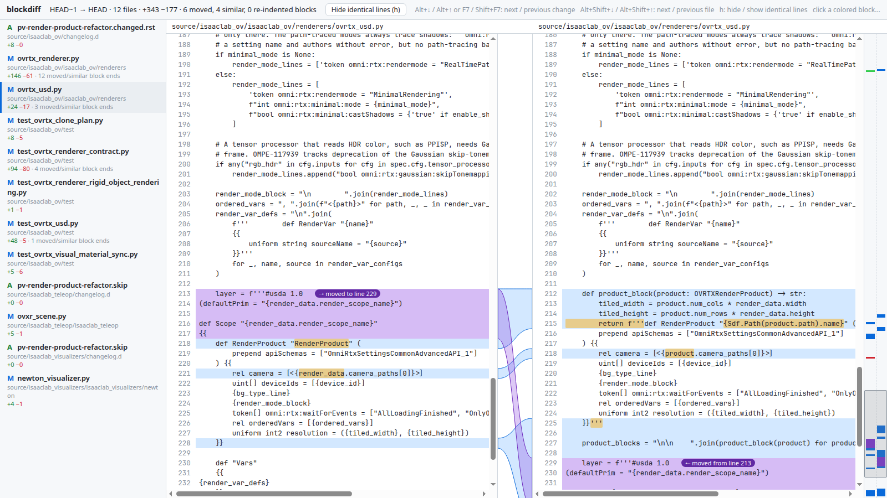
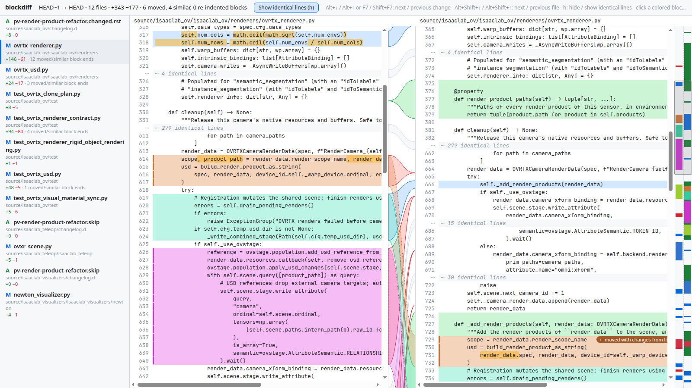

# block-diff

Vibe coded block diff tool with web interface and similar block synchronization.

`blockdiff` compares two versions of a set of files. It finds code blocks that moved, also between files. It also finds blocks that moved and changed. The result is one self-contained HTML page. If Firefox is installed, the page opens in Firefox. If not, the page opens in your default browser.

The design follows Araxis Merge: two synchronized panes with curved connectors between the corresponding blocks.



## Features

- Side-by-side view with synchronized scrolling. Unchanged parts stay aligned.
- Calm scrolling: both panes follow one shared position, so no pane races through added or removed lines. The mouse wheel scrolls at half speed with smooth easing. Jumps to a change also animate.
- An SVG gutter with curved connectors for removed (red), added (green), and changed (blue) blocks.
- Moved-block detection, also between files. Each moved block gets its own color, a connector band, and a link label such as "moved to line 229".
- Detection of blocks that moved and changed. The tool merges the parts of an edited moved block into one block. A dashed band marks these blocks.
- Clear labels: "moved", "moved, only indentation changed", or "moved with 2 changed lines". A marker at the left edge shows the changed lines in a moved block.
- Word-level highlights in changed lines and in edited moved blocks.
- A flat list of all changed files.
- A minimap with the old file in the left half and the new file in the right half. You can click and drag it.
- Identical lines are hidden by default. Three context lines stay above and below each change. Press `h` to show all lines. The page remembers your choice.
- Syntax colors for Python files. The colors change only the text, so the diff backgrounds stay clear. Dark mode uses pale pastel colors.
- Light and dark mode, from the browser setting.



## Requirements

- Python 3.10 or later. The tool uses only the Python standard library.
- Git, for the revision modes.
- A web browser.

## Installation

1. Clone this repository.
2. Put a link to the script in a folder on your `PATH`:

   ```bash
   ln -s "$PWD/blockdiff" ~/.local/bin/blockdiff
   ```

## Usage

Run these commands in a Git repository:

```bash
blockdiff                      # HEAD against the working tree
blockdiff HEAD~1               # HEAD~1 against the working tree
blockdiff HEAD~1 HEAD          # two revisions
blockdiff main...HEAD          # merge base of main and HEAD against HEAD
blockdiff --dirs LEFT RIGHT    # two folders
```

Options:

| Option | Meaning |
|---|---|
| `-C PATH` | Use the repository at `PATH` instead of the current folder. |
| `-o FILE` | Write the HTML page to `FILE`. The default is `/tmp/blockdiff-<uid>/blockdiff.html`. |
| `--no-open` | Do not open the browser. |
| `--paths PATH ...` | Compare only these paths. |

You can also add a link to a specific file and line: `page.html#f=ovrtx_usd.py&l=200&fold=1`. The parameter `f` is a file index or the end of a path. The parameter `l` is a line number on the left side. The parameter `fold` sets the "hide identical lines" mode.

## Use as a Git difftool

The folder mode works with `git difftool --dir-diff`. Git then gives all changed files to `blockdiff` in one call:

```bash
git config --global difftool.blockdiff.cmd 'blockdiff --dirs "$LOCAL" "$REMOTE"'
git difftool -d -t blockdiff HEAD~1
```

The page contains a copy of all files. Thus Git can safely delete its temporary folders after the call.

## Settings

The page keeps the "hide identical lines" setting in the browser `localStorage`. Firefox gives each local file its own storage. For this reason, `blockdiff` always writes to the same file by default. Each new diff replaces this file. An open tab keeps its content until you reload it.

The code uses JetBrains Mono at 14 px with a 20 px line height if the font is installed. Otherwise it uses the default monospace font.

## Keyboard shortcuts

| Keys | Action |
|---|---|
| `Alt+Down` / `Alt+Up` | Go to the next or previous change (Meld, WinMerge, Araxis). |
| `F7` / `Shift+F7` | Go to the next or previous change (VS Code). |
| `n` / `p` | Go to the next or previous change. |
| `Alt+Shift+Down` / `Alt+Shift+Up`, `j` / `k` | Go to the next or previous file. |
| `h` | Hide or show identical lines. |
| `Esc` | Link the panes again after you aligned a block. |

Click a band in the middle bar to align its left and right parts. Click a moved block to show both copies side by side, also when they are far apart. In both cases the alignment fades out when you scroll away, so the panes return to normal sync. While the alignment is active, the minimap shows a link button instead of the thumb. Click the link button or press `Esc` to link the panes again. For a move to another file, a click opens that file. Click a "⋯ N identical lines" row to show those lines.

## How it works

1. The tool makes a line diff of each file with the Python `difflib` module.
2. It collects all removed and all added lines from all files.
3. It finds exact moves. Two blocks match when their lines are equal after whitespace normalization. A moved block needs at least 20 alphanumeric characters, as in `git diff --color-moved`.
4. It finds similar blocks in the remaining lines. An index of identifiers supplies the candidate lines. A token-level similarity score then extends each candidate into a block.
5. It grows each block over neighboring lines that are similar on both sides. An edited line often stops a block.
6. It merges neighboring parts of one moved block into one block. Two parts merge only when the lines between them look like an edit.
7. It labels a block "moved" when the two sides differ only in whitespace. The label then tells if only the indentation changed.
8. It writes the files, the line classes, and the moves as JSON into one HTML page. JavaScript in the page draws the view.

The analysis is fast enough for the CPU. A diff with 12 files and about 500 changed lines takes about 0.2 s.

## Limits

- Syntax colors only for Python (`.py`, `.pyi`). Other files show without syntax colors.
- No editing or merging.
- The `difflib` diff sometimes aligns lines worse than the Git histogram diff.
- Moved blocks with unchanged lines between them stay separate blocks.
- Files with more than about 10,000 lines make the page slow.

## License

MIT. See [LICENSE](LICENSE).
