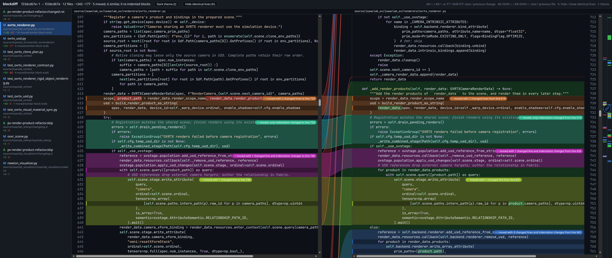
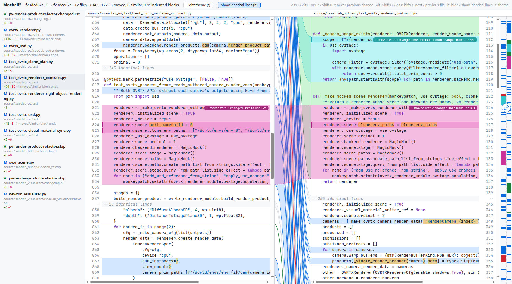
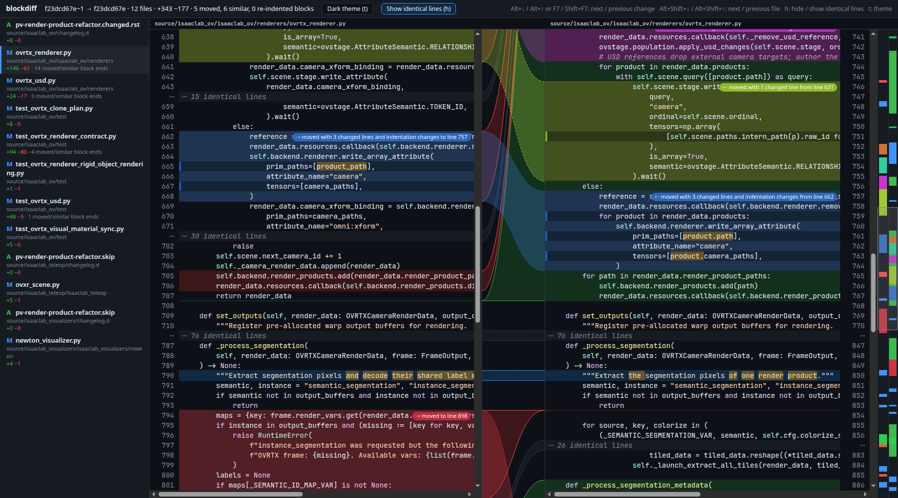
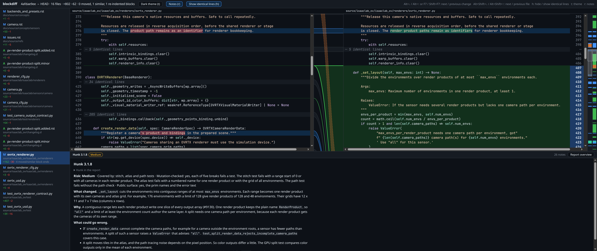

# block-diff

Vibe coded block diff tool with web interface and similar block synchronization.

`blockdiff` compares two versions of a set of files. It finds code blocks that moved, also between files. It also finds blocks that moved and changed. The result is one self-contained HTML page. If Firefox is installed, the page opens in Firefox. If not, the page opens in your default browser.

The design follows Araxis Merge: two synchronized panes with curved connectors between the corresponding blocks.



*A refactor that moves code into a new function. Each moved block has its own color and a link label such as "moved with 2 changed lines to line 729". A click on a label aligns both copies. Word-level highlights show the changed parts. The link button in the minimap links the panes again.*



*A test helper that moved about 700 lines up and changed a little. A click on the label aligns the two copies, with identical lines hidden.*

## Features

- Side-by-side view with synchronized scrolling. Unchanged parts stay aligned.
- Calm scrolling: both panes follow one shared position, so no pane races through added or removed lines. The mouse wheel scrolls at half speed with smooth easing. Jumps to a change, clicks on the minimap, and alignments also animate. Long jumps start slowly, so you can follow the direction. Dragging the minimap thumb glides after the pointer.
- An SVG gutter with curved connectors for removed (red), added (green), and changed (blue) blocks.
- Each changed block extends 1 px above and below in its own color. When a block has no lines on one side, a 2 px band in that color shows where the block belongs.
- Line numbers at the outer edges: left in the left pane, right in the right pane. Thus the code of both panes starts next to the gutter.
- Moved-block detection, also between files. Each moved block gets its own color, a connector band, and a link label such as "moved to line 229".
- Detection of blocks that moved and changed. The tool merges the parts of an edited moved block into one block. A dashed band marks these blocks.
- Clear labels: "moved", "moved, only indentation changed", or "moved with 2 changed lines". A marker at the left edge shows the changed lines in a moved block.
- Word-level highlights in changed lines and in edited moved blocks. Removed words are red on the left. Added words are green on the right. The word diff runs over the whole changed block, so a reflowed comment marks only the words that really changed.
- A flat list of all changed files. The selected file has a blue background and a bold name. Double-click a file to open it in VS Code at the line that shows in the right pane.
- Resizable panes: drag the middle bar to the left or right. Double-click it to restore the 50/50 split. The page remembers the split.
- A minimap with the old file in the left half and the new file in the right half. Both halves use the shared scroll position. The thumb is a frame with one view in each half. Each view marks the rows that its pane shows. Thus you can see when one pane shows more of its file than the other, for example next to a long insertion. While blocks are aligned, the frame gives way to a link button, and the two views show both pane positions. You can click and drag the thumb.
- Identical lines are hidden by default. Three context lines stay above and below each change. Press `h` to show all lines. The page remembers your choice.
- Syntax colors for Python files. The colors change only the text, so the diff backgrounds stay clear. Dark mode uses pale pastel colors.
- Light and dark themes. A button (or `t`) switches between the system theme, dark, and light. The page remembers your choice.
- Review notes: with `--notes`, a panel under the panes shows the note of the selected change from a Markdown review report. See [Review notes](#review-notes).



*Identical lines hidden, with three context lines around each change. The minimap shows the old file in the left half and the new file in the right half.*

## Requirements

- [uv](https://docs.astral.sh/uv/). The script starts with `uv run --script`, and uv installs its one dependency, `markdown-it-py`, on the first run. Without uv, run `python3 blockdiff`. Python 3.10 or later is then enough for everything except `--notes`, which also needs `markdown-it-py`.
- Git, for the revision modes.
- A web browser.

## Installation

1. Clone this repository.
2. Put a link to the script in a folder on your `PATH`:

   ```bash
   ln -s "$PWD/blockdiff" ~/.local/bin/blockdiff
   ```

## Usage

Run these commands in a Git repository:

```bash
blockdiff                      # HEAD against the working tree
blockdiff HEAD~1               # HEAD~1 against the working tree
blockdiff HEAD~1 HEAD          # two revisions
blockdiff main...HEAD          # merge base of main and HEAD against HEAD
blockdiff --dirs LEFT RIGHT    # two folders
```

Options:

| Option | Meaning |
|---|---|
| `-C PATH` | Use the repository at `PATH` instead of the current folder. |
| `-o FILE` | Write the HTML page to `FILE`. The default is `/tmp/blockdiff-<uid>/blockdiff.html`. |
| `--no-open` | Do not open the browser. |
| `--paths PATH ...` | Compare only these paths. |
| `--pr PR` | Link the line numbers to this GitHub pull request (number or URL). The default is the pull request of the current branch. |
| `--no-pr` | Do not look up a GitHub pull request. |
| `--notes REPORT.md` | Show the notes of a review report in a panel under the panes. |

You can also add a link to a specific file and line: `page.html#f=ovrtx_usd.py&l=200&fold=1`. The parameter `f` is a file index or the end of a path. The parameter `l` is a line number on the left side. The parameter `fold` sets the "hide identical lines" mode.

## Use as a Git difftool

The folder mode works with `git difftool --dir-diff`. Git then gives all changed files to `blockdiff` in one call:

```bash
git config --global difftool.blockdiff.cmd 'blockdiff --dirs "$LOCAL" "$REMOTE"'
git difftool -d -t blockdiff HEAD~1
```

The page contains a copy of all files. Thus Git can safely delete its temporary folders after the call.

Do not set `diff.tool` to `blockdiff`. Without `-d`, Git calls the tool once for each file, and each call replaces the page of the previous file. Keep another tool for single files.

Two aliases make the daily use short:

```bash
git config --global alias.bd '!blockdiff'                   # git bd main...HEAD
git config --global alias.bdd 'difftool -d -t blockdiff'    # git bdd HEAD~1
```

## Comment on GitHub pull requests

If the GitHub CLI (`gh`) finds a pull request for the current branch, the line numbers become links. The header then shows the pull request number. The lookup runs in the background while the analysis runs.

- Click a line number to open that line in the "Files changed" page of the pull request. Left line numbers open the old side, right line numbers the new side.
- Shift+click a second line number on the same side to open the range between the two lines.
- To write the comment, click the "+" next to the line on GitHub. GitHub has no link that opens the comment box directly.

Log in to GitHub first. Without a login, GitHub opens the page but does not scroll to the line. All clicks reuse one browser tab. GitHub can only show lines in the diff of the pull request, and only lines in or near a change accept comments. If your diff differs from the pull request diff, for example because of uncommitted changes, the line numbers can differ too.

## Review notes

A review report explains each hunk of a change, for example with "what", "why", and "risks". An agent that wrote the code can write such a report. With `--notes`, a panel under the panes shows the note of the selected change:

```bash
blockdiff main...HEAD --notes review.md
```

- A click on a change, a click on its band in the middle bar, or a jump with `n`, `p`, or `F7` selects the change. The selected change has highlighted line numbers.
- When you scroll the selected change off the screen, the change nearest to the middle of the screen becomes the selection.
- If one change overlaps several notes, the panel shows all of them.
- The "Report overview" button shows the start of the report, and the notes that match no change.
- Drag the top edge of the panel to change its height. Press `r` to hide or show the panel.
- Drag the left edge of the panel to the right to make room under the left pane. Drop it at the left edge of the right pane to keep the panel under the right pane, also when you move the middle bar. Double-click the left edge to restore the full width.



*The new method `_set_layout` is selected. Its line numbers are highlighted, and the panel shows its note with the risk class from the report.*

The report is Markdown with this convention:

- A heading with the file path in backticks starts the notes of that file, for example ``### 3.1 `source/pkg/module.py` ``. The path can be the full path or its end.
- Each note is a section under that heading, for example `#### Hunk 3.1.2`. The note contains the hunk in a fenced code block with the language `diff`, including its `@@` header.
- Optional: `**Risk: High**`, `**Risk: Medium**`, or `**Risk: Low**` in the note. The panel shows the risk class next to the title.

The tool finds each hunk by its content, not by the line numbers in the `@@` header. A note thus still finds its lines after a rebase or after more commits. If the code changed after the report, the tool uses the lines that it still finds. The panel then marks the note as "approximate". The tool prints the number of notes that match no change. Raw HTML in the report shows as text.

## Open files in VS Code

A double-click on a file in the list opens a `vscode://file/...` link. VS Code installs the handler for these links. The first time, the browser asks if it can open the link. In revision mode, the link opens the file in the working tree. In folder mode, it opens the file in the right folder. Git difftool deletes its temporary copies after the call, so these files have no link. Working tree files in the difftool folder are links to the working tree, so these files keep their link.

## Settings

The page keeps the "hide identical lines", theme, pane split, and notes panel settings (shown, height, left edge) in the browser `localStorage`. Firefox gives each local file its own storage. For this reason, `blockdiff` always writes to the same file by default. Each new diff replaces this file. An open tab keeps its content until you reload it.

The code uses JetBrains Mono at 14 px with a 20 px line height if the font is installed. Otherwise it uses the default monospace font.

## Keyboard shortcuts

| Keys | Action |
|---|---|
| `Alt+Down` / `Alt+Up` | Go to the next or previous change (Meld, WinMerge, Araxis). |
| `F7` / `Shift+F7` | Go to the next or previous change (VS Code). |
| `n` / `p` | Go to the next or previous change. |
| `Alt+Shift+Down` / `Alt+Shift+Up`, `j` / `k` | Go to the next or previous file. |
| `h` | Hide or show identical lines. |
| `Esc` | Link the panes again after you aligned a block. |
| `t` | Switch the theme: system, dark, light. |
| `r` | Hide or show the review notes panel (with `--notes`). |

Drag the middle bar to resize the panes. Double-click it to make both panes equally wide again. Click a band in the middle bar to align its left and right parts. Click a moved block to show both copies side by side, also when they are far apart. In both cases the alignment fades out when you scroll away, so the panes return to normal sync. While the alignment is active, the minimap shows a link button instead of the thumb. Click the link button or press `Esc` to link the panes again. For a move to another file, a click opens that file. Click a "⋯ N identical lines" row to show those lines.

## How it works

1. The tool makes a line diff of each file with the Python `difflib` module.
2. It collects all removed and all added lines from all files.
3. It finds exact moves. Two blocks match when their lines are equal after whitespace normalization. A moved block needs at least 20 alphanumeric characters, as in `git diff --color-moved`.
4. It finds similar blocks in the remaining lines. An index of identifiers supplies the candidate lines. A token-level similarity score then extends each candidate into a block.
5. It grows each block over neighboring lines that are similar on both sides. An edited line often stops a block.
6. It merges neighboring parts of one moved block into one block. Two parts merge only when the lines between them look like an edit.
7. It labels a block "moved" when the two sides differ only in whitespace. The label then tells if only the indentation changed.
8. It writes the files, the line classes, and the moves as JSON into one HTML page. JavaScript in the page draws the view.

The analysis is fast enough for the CPU. A diff with 12 files and about 500 changed lines takes about 0.2 s.

## Limits

- Syntax colors only for Python (`.py`, `.pyi`). Other files show without syntax colors.
- No editing or merging.
- The `difflib` diff sometimes aligns lines worse than the Git histogram diff.
- Moved blocks with unchanged lines between them stay separate blocks.
- Files with more than about 10,000 lines make the page slow.

## License

MIT. See [LICENSE](LICENSE).
